# Windows-Server-2022-ActiveDirectory-Lab
Hands-on Enterprise IT Helpdesk Lab built with Oracle VirtualBox, Windows Server 2022, Active Directory Domain Services, and Windows 11. Demonstrates 1st Line Service Desk ticket troubleshooting, user onboarding, and GPO administration.

## 📋 Table of Contents
* [Overview & Prerequisites](#overview--prerequisites)
* [Part 1: Environment & Windows Server 2022 Installation](#part-1-environment--windows-server-2022-installation)
* [Part 2: Active Directory & Domain Controller Setup](#part-2-active-directory-and-domain-controller-setup)
* [Part 3: VirtualBox Guest Additions, User Onboarding & Active Directory Administration](#part-3-guest-and-user-onboarding)
* [Part 4: Windows 11 VM Installation, Host-Only Networking, Domain Join & User Login](#part-4-windows11-installation-and-joining-domain)
 

---

## 📌 Overview & Prerequisites
This project documents a hands-on IT Helpdesk practice lab modeled after enterprise infrastructure. It demonstrates foundational 1st Line Service Desk capabilities—including OS deployment, Active Directory administration, user onboarding, and endpoint troubleshooting.

### Core Technologies
* **Hypervisor:** Oracle VirtualBox (v7.1.4) 
* **Server OS:** Windows Server 2022 (64-bit ISO)
* **Client OS:** Windows 11 Enterprise (ISO via Media Creation Tool)

---

<b>🛠️ Part 1: Environment & Windows Server 2022 Installation (Click to Expand)</b>

 

### 1. Software Downloads
1. Downloaded and installed **Oracle VirtualBox 7.1.4**.
2. Acquired the **Windows Server 2022 64-bit ISO** evaluation file from Microsoft.
3. Generated the **Windows 11 ISO** using the Windows 11 Media Creation Tool (`Create ISO file` option).

---

### 2. Virtual Machine Allocation
1. Opened VirtualBox Manager and selected **New**.
2. Configured VM properties:
   * **Name:** `Server 2022` 
   * **OS Type:** `Windows 2022` 
3. Allocated virtual hardware resources:
   * **Base Memory (RAM):** 8192 MB (8 GB)
   * **Processors:** 2 vCPUs 
   * **Storage:** Created standard virtual disk image

---

### 3. Windows Server 2022 OS Deployment
1. Attached the **Windows Server 2022 ISO** image to the VM optical drive.
2. Booted the VM and selected **Windows Server 2022 Datacenter (Desktop Experience)** to enable the graphical user interface (GUI).
3. Performed custom installation and allowed the OS installer to copy files and finish updates.
4. Following the system reboot, removed/unmounted the ISO installation disk from the virtual drive.

---

### 4. Post-Installation Configuration & Verification
1. Configured the primary local **Administrator account password** and signed in via `Ctrl + Alt + Delete`.
2. Opened **Server Manager** and updated the system **Time Zone** from Pacific Time to local Eastern Time.
3. Adjusted VirtualBox display scaling under `Virtual Screen 1 -> 125%` for optimal screen visibility.
4. Tested administrative Command Prompt CLI utilities for remote system management:
   * `shutdown /i` — Opened the Graphical Remote Shutdown interface
   * `shutdown /s` — Standard full system shutdown
   * `shutdown /r` — Full system reboot
   * `shutdown /?` — Displayed full command parameter list

---

<b>🎯 Part 2: Active Directory Domain Services (AD DS) & Domain Controller Setup (Click to Expand)</b>

 

### 1. Hostname Customization & Server Reboot
1. Signed into Windows Server 2022 as the local Administrator.
2. Opened **Server Manager -> Local Server** and selected the default generated computer name (e.g., `WIN-0907...`).
3. Renamed the computer to **`LC-DC-01`** (representing Domain Controller 01 in Leicester) to align with enterprise naming standards.
4. Restarted the virtual machine to apply the new system hostname.

---

### 2. Active Directory Domain Services (AD DS) Role Installation
1. Opened **Server Manager**, selected **Manage -> Add Roles and Features**.
2. Selected **Role-based or feature-based installation** and designated `LC-DC-01` as the destination server.
3. Selected **Active Directory Domain Services (AD DS)** and accepted all required default dependency features.
4. Completed the role installation wizard.

[AD DS Feature Installation](server_2022_images/add-ad-ds-feature-01.png)

---

### 3. Domain Controller Promotion (PowerShell Scripting Method)
1. Selected the **Notification flag** in Server Manager and clicked **Promote this server to a domain controller**.
2. Selected Deployment Operation: **Add a new forest** and set the Root Domain Name to **`shammahdube.com`**.
3. Set the Directory Services Restore Mode (DSRM) password.
4. On the review screen, clicked **View Script** to export the automatically generated deployment script.
5. Closed the wizard, launched **PowerShell (Run as Administrator)**, pasted the script, entered the Safe Mode password, and executed the automated CLI deployment.
6. Allowed the system to complete the promotion process and perform an automatic reboot .

---

### 4. Post-Promotion & Active Directory Verification
1. Signed into the newly established domain as **`SHAMMAHDUBE\Administrator`** .
2. Executed Command Prompt CLI utilities to verify domain controller status and domain health:
   * `whoami` — Confirmed current domain admin identity (`SHAMMAHDUBE\Administrator`)
   * `hostname` — Verified server hostname (`LC-DC-01`)
   * `systeminfo` — Verified Domain (`shammahdube.com`), OS edition, and network parameters
   * `net user administrator /domain` — Queried domain user account parameters directly from Active Directory
3. Opened **Server Manager -> Tools -> Active Directory Users and Computers (ADUC)** to confirm AD administration tools are operational.

---

<b>🛠️ Part 3: VirtualBox Guest Additions, User Onboarding & Active Directory Administration (Click to Expand)</b>

 

### 1. VirtualBox Guest Additions & Shared Folder Integration
1. Booted Windows Server 2022 VM and logged in as `SHAMMAHDUBE\Administrator`.
2. From the VirtualBox menu bar, navigated to **Devices -> Insert Guest Additions CD image...**.
3. Opened **File Explorer -> This PC**, opened the mounted Guest Additions optical drive, and executed `VBoxWindowsAdditions.exe`.
4. Followed the setup wizard (`Next -> Next -> Install`) and rebooted the server to apply driver enhancements.
5. Configured host-to-guest file sharing in VirtualBox settings (**VM Settings -> Shared Folders**):
   * Added a host folder mapping named `helpdesklab`.
   * Selected **Auto-mount** and **Make Permanent**.
6. Verified two-way clipboard/file transfers by copying files from the host machine directly into the VM shared folder.

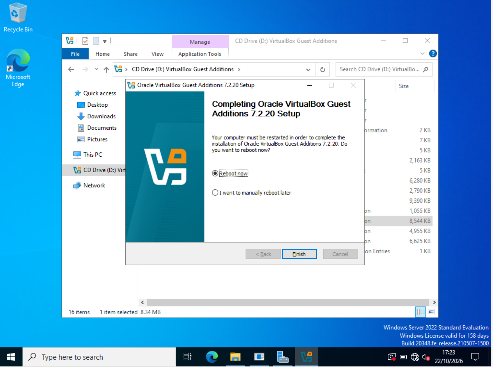
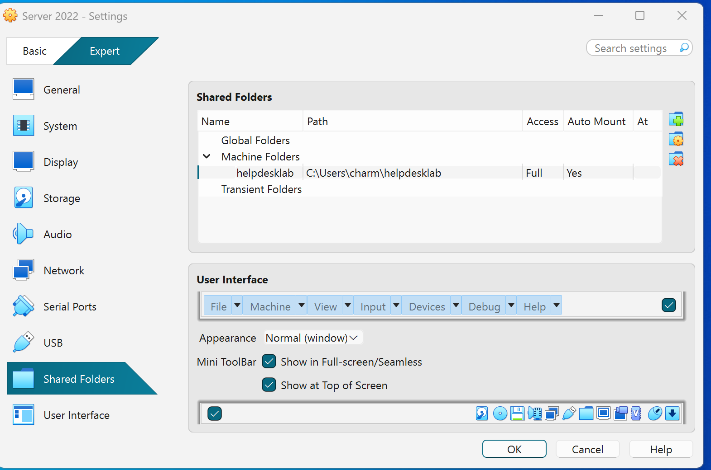
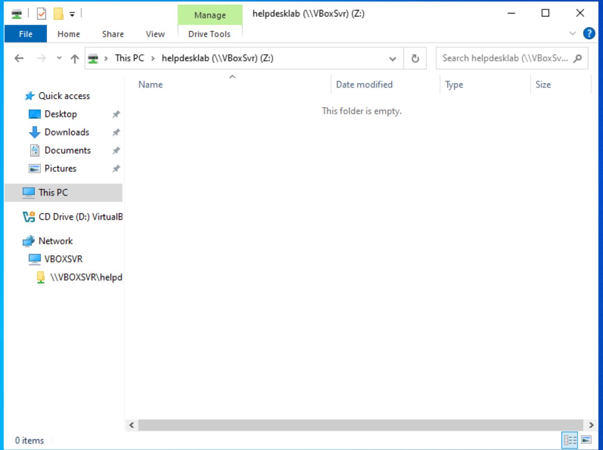

---

### 2. Active Directory User Account Provisioning
1. Launched **Server Manager -> Tools -> Active Directory Users and Computers (ADUC)**.
2. Expanded the domain tree (`shammahdube.com`) and navigated to the **Users** container.
3. Provisioned new domain user accounts via **New -> User** wizard:
   * **User 1:** First Name: `Keith`, User logon name: `keith`
   * **User 2:** First Name: `Shammah`, User logon name: `shammah`
4. Configured initial passwords and completed account creation.

---

### 3. Service Desk User Administration & Account Management
Executed core 1st Line IT Support account management tasks directly within ADUC:
* **User Attribute Updates:** Double-clicked user (`Keith`) to update organizational properties including address, country/region (United States), telephone number, job title, department, company, and reporting manager.
* **Password Reset:** Right-clicked user -> selected **Reset Password** to simulate user password recovery requests.
* **Disabling / Enabling Accounts:** Right-clicked user -> selected **Disable Account** (verifying downward arrow overlay icon) and **Enable Account**.
* **Account Unlock:** Double-clicked user -> **Account** tab -> checked **Unlock account** to resolve user account lockouts.
* **Logon Hours Enforcement:** Opened **Account -> Logon Hours** to configure permitted login windows (e.g., restricting access outside business hours).

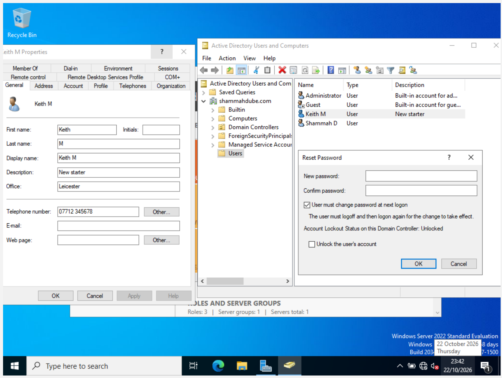

---

### 4. Command Line (CLI) User Account Verification
1. Opened **Command Prompt** (`cmd.exe`).
2. Executed Active Directory CLI queries to inspect domain user account parameters:
   * `net user Keith /domain` — Queried domain user account status, password expiration timestamps, account active state, and assigned group memberships.
   * `net user Shammah /domain` — Verified second newly created domain user account directly against AD.

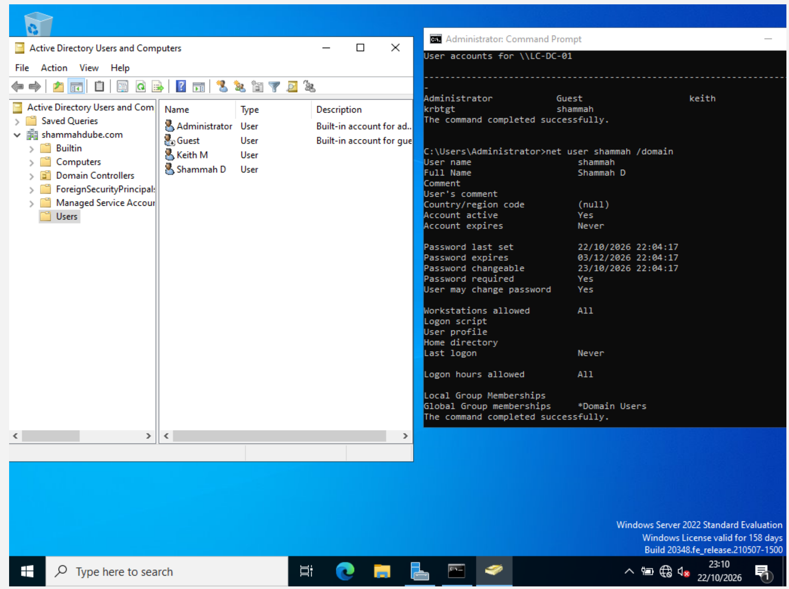

---

<b>💻 Part 4: Windows 11 VM Installation, Host-Only Networking, Domain Join &amp; User Login (Click to Expand)</b>

 

### 1. Windows 11 Virtual Machine Creation &amp; Resource Allocation
1. Opened VirtualBox Manager and selected **New** to create the client workstation VM.
2. Configured VM general properties:
   * **Name:** `Windows 11`
   * **OS Type:** `Microsoft Windows` -&gt; `Windows 11 (64-bit)`
3. Allocated virtual hardware resources:
   * **Base Memory (RAM):** 4096 MB (4 GB RAM)
   * **Processors:** 2 vCPUs
   * **Storage:** Allocated an 80 GB virtual hard disk (`Windows 11.vdi`).
4. Attached the **Windows 11 ISO** (`Windows11_Client_x64_en-us_26300_9457.iso`) to the VM optical drive controller.

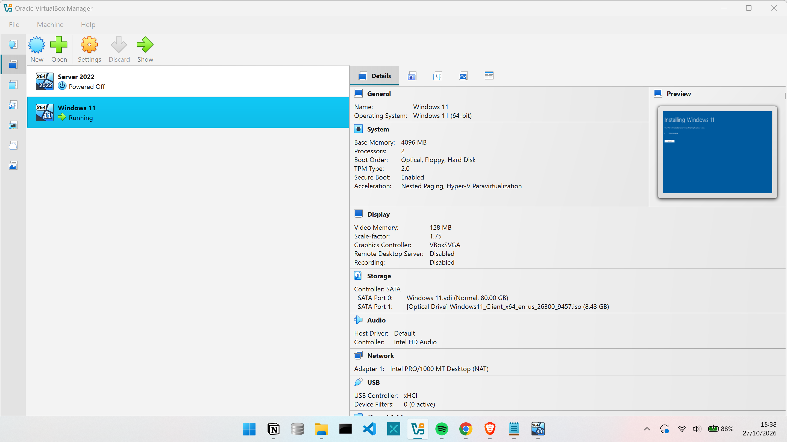

---

### 2. Windows 11 OS Installation &amp; Local Setup
1. Booted the virtual machine from the mounted ISO image.
2. Selected **Windows 11 Pro** (Version 26H2) during operating system setup.
3. Completed custom installation onto the 80 GB unallocated virtual drive.
4. Completed the initial Out-of-Box Experience (OOBE) setup:
   * Created local user account **`Shammah`**.
5. Verified installation under **Settings -&gt; System -&gt; About**, confirming device name **`shmmh-win11-lab`** and 4.00 GB installed RAM.

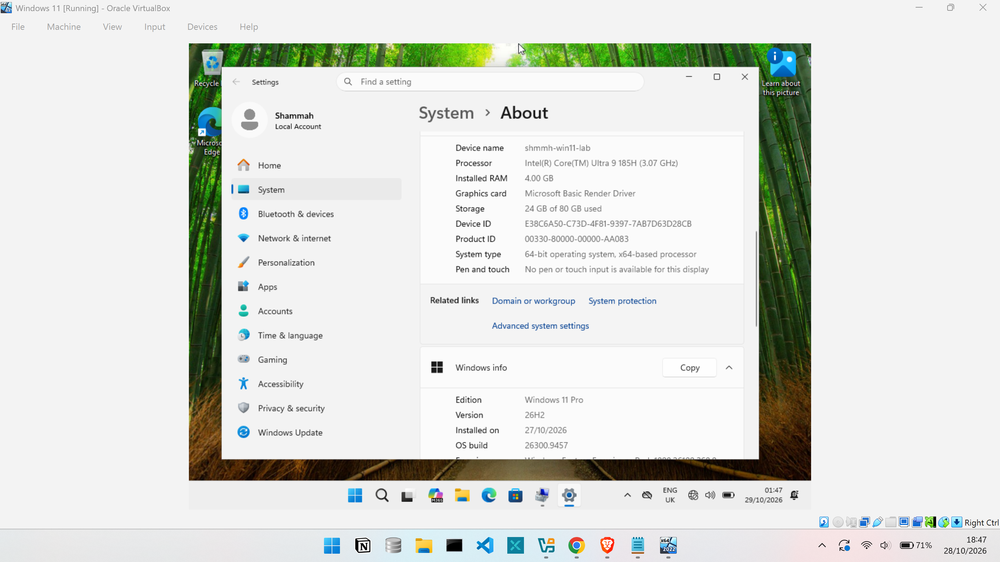

---

### 3. Isolated Subnet &amp; Static IPv4 / DNS Alignment
1. In VirtualBox settings for both `LC-DC-01` and `Windows 11`, assigned the network adapter to **Host-Only Adapter** for isolated subnet communication.
2. On `shmmh-win11-lab`, navigated to **Control Panel -&gt; Network and Sharing Center -&gt; Change Adapter Settings**.
3. Configured **TCP/IPv4 Properties**:
   * **IP Address:** `10.1.10.3`
   * **Subnet Mask:** `255.0.0.0`
   * **Default Gateway:** `10.1.10.1`
   * **Preferred DNS Server:** `10.1.10.2` *(Points to Domain Controller `LC-DC-01` for Active Directory name resolution)*.
4. Verified network connectivity via Command Prompt:
   * `ipconfig /all` — Confirmed local IP (`10.1.10.3`) and DNS server settings.
   * `ping 10.1.10.2` — Verified Layer 3 ICMP reachability from client (`10.1.10.3`) to Domain Controller (`10.1.10.2`).

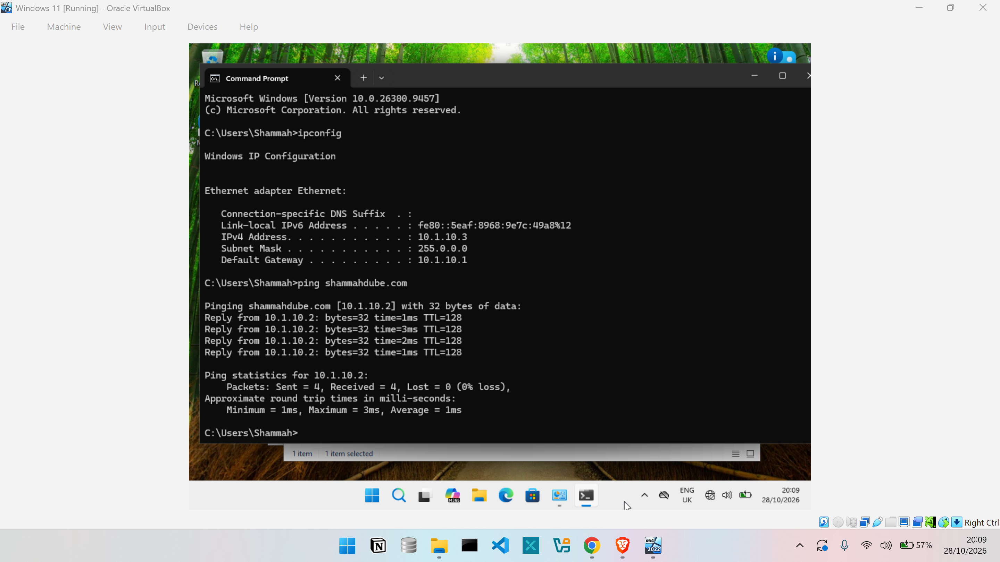

---

### 4. Workstation Rename &amp; Active Directory Domain Join
1. Opened **System Properties** (`sysdm.cpl`) on `shmmh-win11-lab` and selected **Computer Name -&gt; Change**.
2. Specified Member of: **Domain** -&gt; `shammahdube.com`.
3. Authenticated using Domain Admin credentials (`SHAMMAHDUBE\Administrator` + password).
4. Confirmed the **"Welcome to the shammahdube.com domain"** confirmation pop-up and restarted the workstation.
5. *(Active Directory Verification)* Opened **Active Directory Users and Computers (ADUC)** on `LC-DC-01` and verified `shmmh-win11-lab` was registered under the **Computers** container.

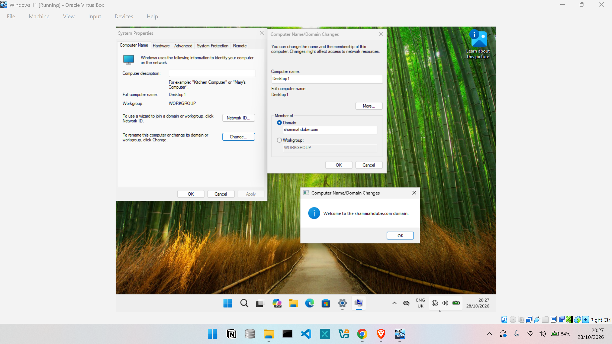

---

### 5. First Domain User Logon &amp; Endpoint Onboarding
1. At the Windows 11 login screen, selected **Other User**.
2. Authenticated using the domain user account **`SHAMMAHDUBE\keith`**.
3. Initialized the desktop profile and allowed domain policies to apply.
4. Verified the active domain session via **Command Prompt**:
   * `whoami` — Confirmed active user identity as `SHAMMAHDUBE\keith`.
   * `net config workstation` — Verified Domain Membership (`shammahdube.com`) and Logon Server (`\\LC-DC-01`).

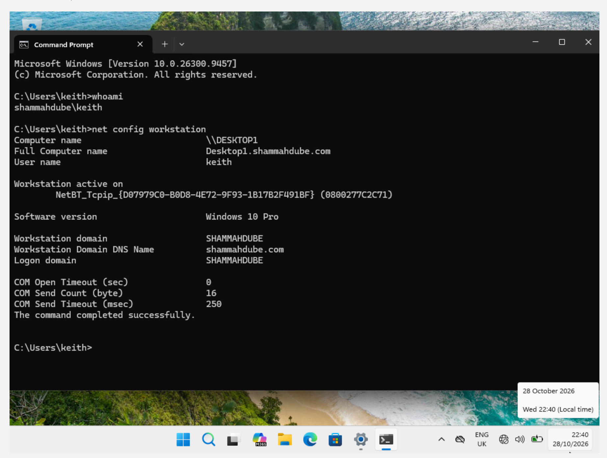

---

### 6. Remote Desktop Protocol (RDP) Administration Verification
1. On `LC-DC-01`, enabled Remote Desktop under **System Properties -&gt; Remote** and granted permissions to domain users.
2. On `shmmh-win11-lab`, launched **Remote Desktop Connection** (`mstsc.exe`).
3. Connected to `10.1.10.2` to initiate a remote management session into `LC-DC-01`.

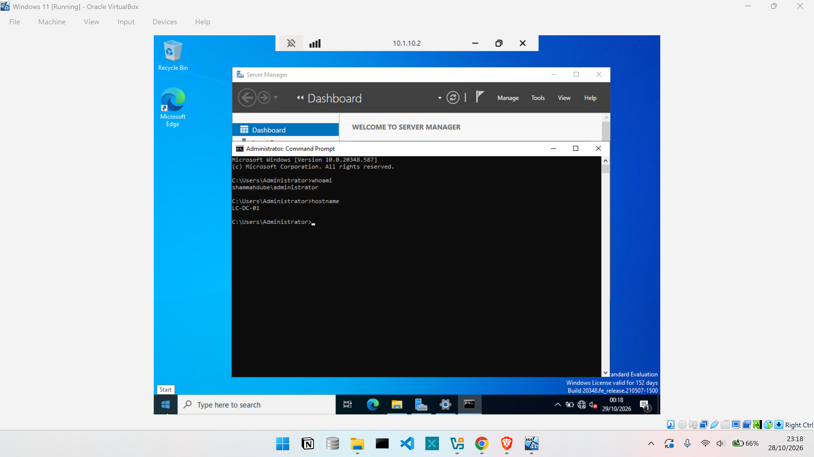

---
